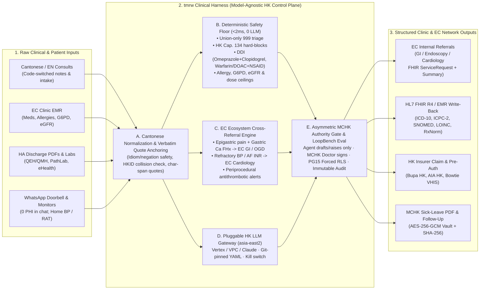

# tmrw Clinical Harness — One-Page Architecture (EC Healthcare)

> Print-ready A4 landscape visual version: [`docs/EC_ARCHITECTURE_ONEPAGER.html`](EC_ARCHITECTURE_ONEPAGER.html) (open in Chrome/Safari → Print → Save as PDF).

## Core Architectural Invariants
- **Asymmetric Authority:** The harness and LLM agents can only *open*, *draft*, or *raise urgency*. Only an authenticated Hong Kong MCHK-registered clinician can sign prescriptions, sick-leave certificates, or internal EC specialist referrals.
- **Deterministic Floor First:** Clinical red flags, Hong Kong Cap. 134 Dangerous Drugs, DDIs, allergy cross-reactivity, G6PD, renal dosing, and EC cross-referral triggers execute deterministically in <2 ms with zero LLM involvement.
- **Hong Kong Residency & PDPO (Cap. 486):** Runs in `asia-east2` (Hong Kong) on Cloud Run + Cloud SQL PostgreSQL 15 with Forced Row-Level Security across all 21 tenant-scoped tables and per-document AES-256-GCM Vault encryption.
- **Model-Agnostic & Continuously Gated:** Swap underlying foundation models without rewriting clinical safety rules; every change is scored against `LoopBench` (0 hard fails, 0 made-up quotes).
