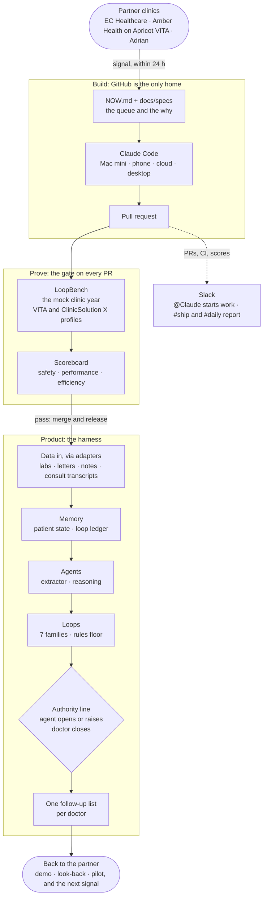

# Operating system (v2, 5 Nov 2026)

One product, one queue, one gate. Every session, on every surface, works from this repo and ends in a pull request.
This replaces the 28 Oct "AI-Native Builder: Operating System" doc. It changes at the 1 Feb 2027 review, or by a PR
that says why in `docs/DECISIONS.md`.

## The one thing

- **The product** is this repo: the follow-up harness. It finds the loops a clinic leaves open and puts each one, with
  its evidence, in front of the doctor who owns it. "Cloud Doctor" is where it is heading. The safety net ships first.
- **The test bed** is [LoopBench](https://github.com/flytonewyork/loopbench): a simulated Hong Kong clinic year with a
  hidden answer key. Every change is scored there before it touches real data.
- **The North Star** is a business signal from real customers, through tmrw consulting: EC Healthcare, Amber Health
  (on Apricot VITA) and Adrian's longevity clinic.
- **The 1 Feb 2027 marker:** an eval harness someone outside your head uses and trusts, and EC work under way.
- Everything else is parked in `NOW.md` until that review.

## The map

The main loop runs signal → spec → build → prove → ship → signal. Each turn of it should leave a partner with something
to react to.

## What changed from the 5 Nov sketch, and why

1. **Customers start and end the loop.** "Sales / customer service" had no arrows. Every partner contact now becomes a
   signal note (issue template), and every release goes back out as a demo, look-back or pilot.
2. **The mock clinic moved to the gate.** LoopBench is where the product is proven, not where data comes from. Real
   data comes in through adapters: the LoopBench feed today, EC's export for the Phase 0 look-back next, the Apricot
   VITA interface once the 6 Nov call says what exists.
3. **Evals are the gate, not a side box.** Every PR in either repo runs the scoreboard. A hard fail or a made-up quote
   blocks the merge. Performance and efficiency changes show in the PR for you to judge.
4. **Two kinds of eval.** Offline, LoopBench scores every change. Online is the gap: the seven platform checks
   (evidence, quotes, identity, searches, duplicate, owner, reasoning) run only inside LoopBench today, and the
   extractor already refuses quotes a document doesn't contain. Running the same checks on every item the product
   opens is its observability, and it has to exist before real data does (`NOW.md`).
5. **Consult transcripts are a document source, not memory.** They come in through the same adapters as labs and
   letters, and every claim built on them quotes them word for word.
6. **The authority line is on the map.** The agent can open an item or raise its urgency. Only a doctor closes one.
7. **Slack starts work and reports it; GitHub holds it.** `@Claude` in a thread starts a session that ends in a PR, and
   `#ship` and `#daily` report back. The queue and decisions live in the repo, never only in a thread. No patient data
   in Slack, ever.
8. **Two screens, two jobs.** The doctor's follow-up list (`frontend/`) is the product. LoopBench Studio
   (`loopbench/web`) is the lab: demos and debugging.
9. **"Memory" means two things.** Product memory is patient state and the loop ledger: append-only, the audit trail.
   Builder memory is `CLAUDE.md`, `NOW.md` and `docs/DECISIONS.md`: in git, never only in a chat.

## Rules

1. **GitHub is the only home.** A chat, a container, a Claude Doc or an artifact is scratch space until its content is
   in a PR. If it isn't in GitHub, it doesn't exist.
2. **One queue.** `NOW.md` holds one milestone, at most three items in progress, and everything else in order. A new
   idea gets one line under Parked and waits for the 1 Feb review.
3. **Same start, same end.** Start by reading `NOW.md`. End with a PR that names the item it moves, carries the
   scoreboard and updates `NOW.md`. The session protocol is in `CLAUDE.md`.
4. **Small, proven PRs.** One item per PR. Behaviour changes go behind a new rules version, so the v1.0 floor stays
   comparable.
5. **Docs and artifacts are views.** Write it in the repo first. A Claude Doc or artifact for a partner is a copy that
   says which commit it came from. Studio is published from `loopbench/scripts/build_studio.py`.
6. **Write it down once.** A correction made twice becomes a line in `CLAUDE.md`, a test or a check.
7. **Synthetic data only** in repos, chats, Slack and frontier models. Real data stays where the partner allows, on a
   model permitted in Hong Kong.

## Where work runs

| You start from | It runs on | It ends as |
|---|---|---|
| Phone, Claude app | Mac mini through Remote Control, both repos side by side | a PR |
| A claude.ai chat | a cloud session with both repos attached, with push access | a PR |
| The desk | Claude Code on the Mac | a PR |
| A model-backed run (`claude -p` extraction) | the Mac mini only, where the CLI is logged in | cached outputs, committed, replayed in CI |
| A Slack thread (`@Claude` in `#thomas-claude`) | a Claude Code cloud session on your plan | a PR |
| A schedule | a scheduled task | a PR or a Slack post |

The code expects the two repos side by side (`../harness`, `../loopbench`). One machine owns a branch at a time; push
before switching. A cloud session sets itself up: `scripts/cloud_setup.sh` installs the repo and clones its sibling
before the agent starts (loopbench has the same script).

## Your day

Your job is to decide what gets built and to judge what comes back. Claude does the building: several sessions at
once, most of them started away from the desk, each ending in a PR you review.

| When | Where | What you do |
|---|---|---|
| Before 8, 10 minutes | Phone: `#daily` | Read the brief and answer every ❓. Start the day's tasks from the top of `NOW.md`, one `@Claude` thread each in `#thomas-claude`. |
| Morning, the deep block | Desk: Claude Code on the Mac | The item that needs your judgment: a spec, a partner document, a hard engine change. Plan mode first, then let it run. |
| Between other work | Phone: Slack | Steer a session by replying in its thread. A new idea gets `park this`. A partner contact goes in `#signals` the same day. |
| Afternoon, 30 minutes | GitHub | Review what came back: the scoreboard and the pre-review on each PR. Merge, or reply with the fix. |
| Evening, 5 minutes | Phone: Remote Control on the Mac mini | Start anything long, such as a model run or a sweep, so it runs overnight. |
| Friday, 30 minutes | `NOW.md` | The weekly review (Cadence, below). |

Your review time is the bottleneck, so spend it on the queue and on PRs, not on typing code.

## What to say

The skills in `.claude/skills/` turn a short ask into the whole protocol, on any surface. In Slack, name the repo so
`@Claude` starts a Claude Code session rather than a chat.

| Say | Skill | You get back |
|---|---|---|
| `@Claude in harness: <task>` | ship | A scored PR that names its `NOW.md` item |
| `@Claude in harness, file this signal: <notes>` (in `#signals`) | signal | A `signal` issue, and a `NOW.md` PR if the order changes |
| `@Claude in harness, park this: <idea>` | park | One line under Parked, in a small PR |
| `@Claude in harness, brief me` | brief | Where things stand, in at most 12 lines |
| `@Claude in harness, review PR 12` | review | The gate, the invariants, the risks and a merge call |

When a session gets something wrong twice, reply "add that to CLAUDE.md" in the thread, so the correction lands in the
repo for every later session.

## Slack

Slack is where work starts and results land; GitHub is where it lives. The layout copies how Anthropic runs on
`@Claude` in Slack (a personal channel each, feedback channels, a daily briefing, one thread per session), sized for
one person on a Max plan.

| Channel | Anthropic pattern | What happens there |
|---|---|---|
| `#thomas-claude` (private) | `#yourname-claude` | One thread per task: `@Claude` plus the repo name starts a Claude Code session that ends in a PR |
| `#signals` (private) | Feedback channels | Every partner contact within 24 hours; `@Claude` files it as a `signal` issue |
| `#ship` (public) | A workflow channel wired to GitHub | The GitHub app posts PRs, reviews, releases and CI |
| `#daily` (public) | `#anthropic-times`, the daily briefing | A weekday morning brief from a scheduled task, once Thomas switches it on |

- **Each channel's first message is its brief:** Anthropic treats it as the channel's CLAUDE.md. Pin it.
- **One thread is one session.** Reply in the thread to steer it; start a new thread for a new task.
- **Status on top-level messages:** ⏳ working · ❓ needs you · 🛑 blocked · ✅ merged.
- **Durable rules go in the repo** (`CLAUDE.md`, `NOW.md`, `docs/DECISIONS.md`), not only in a thread.

On a Max plan, `@Claude` in Slack is the earlier Claude Code in Slack. It works in channels, not DMs. It reads the
thread, runs on your plan limits and offers "Create PR". Claude Tag's channel memory, ambient follow-ups and routines
need a Team or Enterprise plan. Here, pinned briefs stand in for channel memory and scheduled tasks stand in for
routines. Revisit if tmrw moves to a Team plan.

Sources: [Claude Code in Slack](https://code.claude.com/docs/en/slack) ·
[Claude Tag for Claude Code users](https://claude.com/docs/claude-tag/concepts/for-claude-code-users) ·
[How Anthropic works with Claude Tag in Slack](https://claude.com/resources/webinars/how-anthropic-works-with-claude-tag-in-slack)

## The scoreboard

One set of numbers, everywhere: CI, PRs, demos and partner documents.
`loopbench/scripts/scoreboard.py` runs three setups (solo GP on ClinicSolution X, solo GP on Apricot VITA, group
practice on Apricot VITA) × three harnesses (rules v1.0, rules v1.1, agentic) × seeds 1–3. It takes a few minutes, and
runs are deterministic, so any change against main is the change itself.

| Group | Measure | In CI |
|---|---|---|
| Safety | Hard fails, including made-up quotes and false all-clears | Must be 0: blocks the merge |
| Safety | Items passing all seven checks | Shown against main |
| Performance | Harm-weighted missed loops per 1,000 patient-years, off → on | Shown against main |
| Efficiency | Precision; items per doctor-day | Shown against main |
| Efficiency | Doctor-minutes per item | Not built yet (`NOW.md`) |
| Value | Recovered consultations a clinic-year | Shown against main |

The Cloud Doctor ladder's measures (critical misses per task class, rung held, actions accepted without edits) join
when the ladder is built.

## Cadence

- **Every session:** the protocol in `CLAUDE.md`.
- **Every partner contact:** a signal note within 24 hours.
- **Fridays, 30 minutes:** read the week's merged PRs and scoreboards, re-order `NOW.md`, prune `CLAUDE.md`.
- **1 Feb 2027:** the direction review. Parked items are debated then, not before.

## Inventory

Every piece of the work, where it lives and its status: `docs/INVENTORY.md`. Re-check it in the Friday review.

## Install (one time)

Done: `#ship` and a `signal` label in both repos (5 Nov). On 6 Nov: the setup PRs merged; `REPOS_TOKEN` added to both
repos; `#thomas-claude`, `#signals` and `#daily` created with their briefs; the Claude app connected, set to Code +
Chat and invited to `#thomas-claude` and `#signals`; the GitHub app subscribed to both repos in `#ship`; both repos
cloned side by side in `~/code` on the Mac mini. The steps left need you, because Claude sessions can't create
credentials or sign in for you.

1. **A new CI token (5 minutes).** The token in `REPOS_TOKEN` can't see the private repos, so CI's checkout of the
   sibling repo gets "Not Found" and every run on main is red. At github.com/settings/personal-access-tokens/new:
   Repository access, Only select repositories, harness and loopbench; Permissions, Contents, Read-only. Paste the new
   token into the `REPOS_TOKEN` secret in both repos (Settings → Secrets and variables → Actions), delete the old
   token, then re-run CI.
2. **Mac mini (2 minutes).** Log the Claude CLI in (`claude`, then `/login`) and turn on Remote Control for each repo.
   The two loose pieces aren't on the Mac mini (`docs/INVENTORY.md`).
3. **The morning brief.** Say "yes" to it in a chat, and Claude creates the scheduled task: weekdays at 06:43 Hong Kong
   time, the `brief` skill, posted to `#daily`.
4. **`@claude` on GitHub (optional, 5 minutes).** In Claude Code on the Mac, with the GitHub CLI signed in, run
   `/install-github-app` in each repo and choose the long-lived token from your Claude subscription. It installs the
   app, saves the secret and opens the workflow PR. Then `@claude` in a PR comment works, for example
   `@claude add this lesson to CLAUDE.md`.
5. **Chats.** When a claude.ai chat asks to attach these repos, allow push access, so the session ends in a PR instead
   of a zip.
