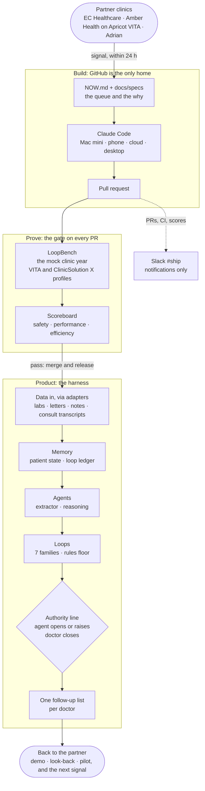

# Operating system (v2, 5 Nov 2026)

One product, one queue, one gate. Every session, on every surface, works from this repo and ends in a pull request.
This replaces the 28 Oct "AI-Native Builder: Operating System" doc. It changes at the 1 Feb 2027 review, or by a PR
that says why in `docs/DECISIONS.md`.

## The one thing

- **The product** is this repo: the follow-up harness. It finds the loops a clinic leaves open and puts each one, with
  its evidence, in front of the doctor who owns it. "Cloud Doctor" is where it is heading. The safety net ships first.
- **The test bed** is [LoopBench](https://github.com/flytonewyork/loopbench): a simulated Hong Kong clinic year with a
  hidden answer key. Every change is scored there before it touches real data.
- **The North Star** is a business signal from real customers, through tmrw consulting: EC Healthcare, Amber Health
  (on Apricot VITA) and Adrian's longevity clinic.
- **The 1 Feb 2027 marker:** an eval harness someone outside your head uses and trusts, and EC work under way.
- Everything else is parked in `NOW.md` until that review.

## The map

The main loop runs signal → spec → build → prove → ship → signal. Each turn of it should leave a partner with something
to react to.

## What changed from the 5 Nov sketch, and why

1. **Customers start and end the loop.** "Sales / customer service" had no arrows. Every partner contact now becomes a
   signal note (issue template), and every release goes back out as a demo, look-back or pilot.
2. **The mock clinic moved to the gate.** LoopBench is where the product is proven, not where data comes from. Real
   data comes in through adapters: the LoopBench feed today, EC's export for the Phase 0 look-back next, the Apricot
   VITA interface once the 6 Nov call says what exists.
3. **Evals are the gate, not a side box.** Every PR in either repo runs the scoreboard. A hard fail or a made-up quote
   blocks the merge. Performance and efficiency changes show in the PR for you to judge.
4. **Two kinds of eval.** Offline, LoopBench scores every change. Online is the gap: the seven platform checks
   (evidence, quotes, identity, searches, duplicate, owner, reasoning) run only inside LoopBench today, and the
   extractor already refuses quotes a document doesn't contain. Running the same checks on every item the product
   opens is its observability, and it has to exist before real data does (`NOW.md`).
5. **Consult transcripts are a document source, not memory.** They come in through the same adapters as labs and
   letters, and every claim built on them quotes them word for word.
6. **The authority line is on the map.** The agent can open an item or raise its urgency. Only a doctor closes one.
7. **Slack only talks.** Results reach you there. Work lives in `NOW.md` and branches, decisions in `docs/DECISIONS.md`
   and PRs. No patient data in Slack, ever.
8. **Two screens, two jobs.** The doctor's follow-up list (`frontend/`) is the product. LoopBench Studio
   (`loopbench/web`) is the lab: demos and debugging.
9. **"Memory" means two things.** Product memory is patient state and the loop ledger: append-only, the audit trail.
   Builder memory is `CLAUDE.md`, `NOW.md` and `docs/DECISIONS.md`: in git, never only in a chat.

## Rules

1. **GitHub is the only home.** A chat, a container, a Claude Doc or an artifact is scratch space until its content is
   in a PR. If it isn't in GitHub, it doesn't exist.
2. **One queue.** `NOW.md` holds one milestone, at most three items in progress, and everything else in order. A new
   idea gets one line under Parked and waits for the 1 Feb review.
3. **Same start, same end.** Start by reading `NOW.md`. End with a PR that names the item it moves, carries the
   scoreboard and updates `NOW.md`. The session protocol is in `CLAUDE.md`.
4. **Small, proven PRs.** One item per PR. Behaviour changes go behind a new rules version, so the v1.0 floor stays
   comparable.
5. **Docs and artifacts are views.** Write it in the repo first. A Claude Doc or artifact for a partner is a copy that
   says which commit it came from. Studio is published from `loopbench/scripts/build_studio.py`.
6. **Write it down once.** A correction made twice becomes a line in `CLAUDE.md`, a test or a check.
7. **Synthetic data only** in repos, chats, Slack and frontier models. Real data stays where the partner allows, on a
   model permitted in Hong Kong.

## Where work runs

| You start from | It runs on | It ends as |
|---|---|---|
| Phone, Claude app | Mac mini through Remote Control, both repos side by side | a PR |
| A claude.ai chat | a cloud session with both repos attached, with push access | a PR |
| The desk | Claude Code on the Mac | a PR |
| A model-backed run (`claude -p` extraction) | the Mac mini only, where the CLI is logged in | cached outputs, committed, replayed in CI |
| A schedule | a scheduled task | a PR or a Slack post |

The code expects the two repos side by side (`../harness`, `../loopbench`). One machine owns a branch at a time; push
before switching.

## The scoreboard

One set of numbers, everywhere: CI, PRs, demos and partner documents.
`loopbench/scripts/scoreboard.py` runs three setups (solo GP on ClinicSolution X, solo GP on Apricot VITA, group
practice on Apricot VITA) × three harnesses (rules v1.0, rules v1.1, agentic) × seeds 1–3. It takes a few minutes, and
runs are deterministic, so any change against main is the change itself.

| Group | Measure | In CI |
|---|---|---|
| Safety | Hard fails, including made-up quotes and false all-clears | Must be 0: blocks the merge |
| Safety | Items passing all seven checks | Shown against main |
| Performance | Harm-weighted missed loops per 1,000 patient-years, off → on | Shown against main |
| Efficiency | Precision; items per doctor-day | Shown against main |
| Efficiency | Doctor-minutes per item | Not built yet (`NOW.md`) |
| Value | Recovered consultations a clinic-year | Shown against main |

The Cloud Doctor ladder's measures (critical misses per task class, rung held, actions accepted without edits) join
when the ladder is built.

## Cadence

- **Every session:** the protocol in `CLAUDE.md`.
- **Every partner contact:** a signal note within 24 hours.
- **Fridays, 30 minutes:** read the week's merged PRs and scoreboards, re-order `NOW.md`, prune `CLAUDE.md`.
- **1 Feb 2027:** the direction review. Parked items are debated then, not before.

## Inventory: what exists and where it belongs

| Piece | Where | Status |
|---|---|---|
| harness | GitHub (this repo) | The product |
| loopbench | GitHub | The test bed |
| Cloud Doctor: AGI-pilled spec | Claude Doc, 5 Nov | The vision. Its hand-off prompt (built on the 3 Nov harness) is superseded by `NOW.md` |
| Data request: Phase 0 look-back | Claude Doc + `docs/EC_DATA_REQUEST.md` | Repo copy canonical; the Doc is the shareable view |
| EC Healthcare demo talk track; Amber Health visit sheet | Claude Docs | Partner views. Each contact ends in a signal note |
| HK primary care: problems ranked by size | Claude Doc | Reference |
| LoopBench Studio; Follow-ups: a simulated clinic year | Artifacts | Views, republished from the repos |
| Core Architecture and 8-Week Plan; MVP Spec and Eval Rubric | Claude Docs, 4 Nov | Superseded by `loopbench/docs/PLAN.md` and this file; bring back what's still needed as `docs/specs/` |
| AI-Native Builder: Operating System | Claude Doc, 28 Oct | Superseded by this file |
| The Case Loop; Clinical AI Evaluation Map | Artifacts, 4 Nov | From before LoopBench. Archive unless a spec needs them |
| clinic-agent-evals (tool contract, 32 cases, scorecard, Grade the judge) | A zip and two artifacts, 3 Nov | **Not in git.** Commit it to loopbench for the planned port (`NOW.md`) |
| clinical_eval (Heidi scribe fidelity) | `~/heidi_eval/clinical` on the Mac, uncommitted | **Not in git.** Commit it to heidi_eval on a branch, then park |
| heidi_eval | GitHub | Parked. The Heidi work sample, not tmrw IP |
| Clinical trials, Bio AI, venture docs | Claude Docs | Parked until 1 Feb 2027 |

## Install (one time)

Done on 5 Nov: `#ship` created in Slack, and a `signal` label in both repos. Steps 0 to 2 need you: Claude sessions
can't merge unreviewed work or set repository secrets, and the GitHub app needs your own sign-in.

0. **Merge.** loopbench #1 first (the harness PR's score job needs its scoreboard script on main), then harness #1.
1. **CI token.** Create a fine-grained GitHub token (github.com/settings/personal-access-tokens/new): repository
   access to harness and loopbench only, permission Contents read-only. Add it as the secret `REPOS_TOKEN` in both repos
   (Settings → Secrets and variables → Actions → New repository secret). Until then, the score jobs warn and skip.
2. **Slack.** Add the GitHub app to your workspace (slack.github.com), then in `#ship` run
   `/github subscribe flytonewyork/harness pulls,reviews,commits,releases,workflows` and the same for
   flytonewyork/loopbench. It asks you to sign in to GitHub the first time.
3. **Mac mini.** Clone both repos side by side and turn on Remote Control for each. Commit the two loose pieces in the
   inventory.
4. **Chats.** When a claude.ai chat asks to attach these repos, allow push access, so the session ends in a PR instead
   of a zip.
