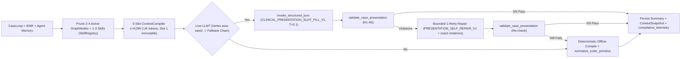

# Track 3 Spec — Agentic Harness Runtime (Live Models + Practice Graph + Widgets + Durable Loops)

*Branch: `feat/live-demo-convergence` · Aligned with `docs/research/SEAM_CONTRACT.md`, `docs/PRODUCT_DECISIONS.md`, and `docs/AGENTIC_ARCHITECTURE.md`*
*Strict Product Invariant: `harness/backend/` NEVER imports `loopbench`.*

---

## 1. Unified Hybrid Model Runtime (`backend/acute/agent_harness.py`)

All clinical LLM inference across `/emr`, `/p/qr/...`, and `/workspace` routes through ONE unified runtime in `backend/acute/agent_harness.py` (zero parallel `llm/` packages, zero duplicate provider clients).

### 1.1 Provider Resolution Chain (`detect_live_llm_engine`)

| Priority | Provider | Model Default | Region | PHI Boundary | Activation Criteria |
| :---: | :--- | :--- | :--- | :--- | :--- |
| 0 | `AGENT_LLM_PROVIDER` override | Provider default or `AGENT_LLM_MODEL` | Provider region | Off-HK scrubbed | Explicit `"deterministic"`/`"off"` or `"vertex"`/`"gemini"`/`"anthropic"`/`"openai"` |
| 1 | **GCP Vertex AI (Primary)** | `gemini-2.5-flash` (`temperature=0.1`) | **`asia-east2` (Hong Kong)** | In-region HK PDPO DPP3 + `X-Vertex-Zero-Data-Retention: true` + `X-No-Training: true` | `VERTEX_PROJECT_ID` / `GOOGLE_CLOUD_PROJECT` / `GCP_PROJECT_ID` + graceful ADC probe (non-crashing in offline CI; explicit `AGENT_LLM_PROVIDER=vertex` activates without requiring live metadata server for mocked tests) |
| 2 | Gemini Developer API | `gemini-2.5-flash` (`temperature=0.1`) | `global` | **Auto `PHIScrubber`** | `GEMINI_API_KEY` |
| 3 | Anthropic Messages API | `claude-sonnet-4-20250514` (`temperature=0.1`) | `us-global` | **Auto `PHIScrubber`** | `ANTHROPIC_API_KEY` |
| 4 | OpenAI Chat Completions | `gpt-4o-mini` (`temperature=0.1`, `store=false`) | `us-global` | **Auto `PHIScrubber`** | `OPENAI_API_KEY` |
| 5 | **Deterministic Offline Fallback** | `clinic-harness-tool-engine-v1` | `local` | Local only | Default when no credentials / ADC unreachable in offline CI (`live: false`) |

### 1.2 Shared Reusable Runtime Helpers
- `ModelCallResult`: typed telemetry envelope (`ok`, `provider`, `model`, `region`, `text`, `json_payload`, `latency_ms`, `phi_scrubbed`, `redacted_categories`, `prompt_tokens`, `output_tokens`, `fallback_used`, `error`).
- `invoke_structured_json(...)`: calls active live provider at `temperature=0.1`, applies `PHIScrubber.scrub()` whenever `region != "asia-east2"`, parses strict JSON (handling fenced markdown blocks), and degrades cleanly to `fallback_used=True` on timeout/error.
- `invoke_clinical_qa(...)`: same regional PHI boundary and provider routing for concise clinical registrar Q&A (`SAM_PRIVATE_REGISTRAR_QA_V1`).
- `safety.screen_red_flags` tool in `MultiAgentHarness._exec_tool`: upgraded to run `triage.screen_acute_message()` (union-only HK 999 / mental-health crisis floor with Cantonese hyperbole safety & clause-scoped negation, unioned with `classify_crisis()` when no hyperbole/negation suppression applies).

---

## 2. Deterministic-First Loops 1 & 2 (`triage.py`, `verification.py`, `emr_connector.py`)

### 2.1 Loop 1 — Bilingual 3-Tier Async Triage (`triage.py` → `workspace_engine.simulate_patient_triage_turn`)
1. **Deterministic Pre-Gate:** `triage.screen_acute_message()` (union-only 999/A&E & Samaritans crisis floor + Cantonese hyperbole suppression + clause-scoped negation) + `triage.extract_intake()` + union prompt-injection detection (`triage.detect_prompt_injection` ∪ `backend.agentic.detect_prompt_injection_signals`).
2. **Medication Safety Reminders:** Real `rx_rules.check_prescription_safety` + G6PD/allergy trigger check (e.g. `g6pd_aspirin_warning` for Aspirin/NSAIDs/Bactrim in G6PD-deficient patients, Penicillin/Amoxicillin/Augmentin allergy warnings).
3. **3-Tier Bilingual Routing (Zero Fake SLA, Zero Unilateral AI Billing):**
   - **Tier 0 (`urgent_exit_999`)**: Red flag or crisis → immediate non-LLM bilingual 999 / A&E (+ Samaritans 24h) banner.
   - **Tier 1 (`self_serve_careline`)**: Logistics, vaccine/flu slot, rescheduling, fasting prep, home BP logs → Careline AI self-serve (`0` doctor minutes).
   - **Tier 2 (`post_visit_grace_my_work`)**: Clarifying post-visit/discharge question within tenant `grace_window_hours` (default `72h`), excluding sick-note / new-Rx requests → `# my-work` with `promise_reply_sla: false`.
   - **Tier 3 (`offer_booking_options`)**: New clinical episode / sick note / Rx / outside grace window → file safety reminder + teleconsult/in-clinic booking options (`ai_unilateral_billing: false`).

### 2.2 Loop 2 — External Document Verification & Fail-Closed Quarantine (`verification.py` + `emr_connector.py` → `workspace_engine.ingest_workspace_document`)
- `verification.check_document_identifiers(source_text)` extends `doc_identifiers()` to parse masked HKID formats (`A412***(8)`, `A412XXX(X)`, full HKID) and MRN tokens (`PAT-\d+`), emitting `hkid_collision`, `dob_collision`, `mrn_collision`, and `has_collision`.
- `verification.verify_external_document_payload(...)` combines `check_document_identifiers`, verbatim quote span anchoring (`verify_quote_span` / `compute_quote_anchors`), cross-site `DoseConflict` detection from `parsed_diff`, and `build_unified_checks` (including `rx_rules` & elderly unknown-eGFR checks).
- **Fail-Closed Gate:** If `verify_three_point_id()` returns `< 3/3` match **OR** `has_identity_collision` is `true` → strictly quarantined to Nurse Rachel (`match_status: "quarantined_nurse"`, `matched_patient_id: null`), never linked to doctor `# my-work` or patient chat.

---

## 3. 5-Slot `<4,096`-Token Presentation Compiler & 1-Retry Self-Repair (`workspace_engine.compile_case_presentation`)

- **Slot Ceiling:** CJK-aware `estimate_tokens()` enforces `total_tokens_est <= 4096` (Slot 1 Safety Floor never truncated; Slots 2–5 pruned deterministically; off-`asia-east2` payloads scrubbed via `PHIScrubber`).
- **Bounded Repair:** At most **1** diagnostic retry (`retry_count <= 1`) passing exact structured `violations` (`rule_id`, `field_path`, `message`, `repair_hint`). If retry still violates `R1`–`R5`, deterministic safe fallback guarantees `5/5` linter pass (`fallback_used: true`).
- **Always-Live X-Ray (`build_workspace_overview` / `get_workspace_overview`):** Always exposes `xray.llm_runtime` (alias `xray.model_runtime`), `xray.linter_summary`, non-null `xray.latest_context_window` (even pre-commit!), and per-case `compilation_telemetry`.

---

## 4. Private Sam Q&A, Structured Order CDS & Durable Outbox (`workspace_engine.py`, `workflows.py`)

### 4.1 Live Private Sam Q&A (`ask_case_agent`)
- Routes through `ContextCompiler(channel="private_sam")` + `SAM_PRIVATE_REGISTRAR_QA_V1` + `agent_harness.invoke_clinical_qa()`.
- Post-generation screened by `screen_agent_output(..., is_sam_note=True)` and `has_objective_sam_signal()` (zero clinician impersonation, zero chatty UI narration).
- Strict isolation: tagged `ephemeral_private: true`, `written_to_emr: false`, NEVER included in EMR addenda or `handoff_payload`.

### 4.2 Structured Preview / Commit / Undo (`preview_case_instruction`, `commit_case_instruction`, `undo_case_execution`)
- Accepts `instruction_text` plus optional `orders` / `structured_orders` (normalized via `practice_graph.normalize_order_primitive`).
- Evaluates `rx` orders through `rx_rules.evaluate_rx_order_primitives()` during both preview and commit (returning `parsed_orders`, `rx_safety_report`, and `handoff_payload` per `SEAM_CONTRACT.md` §5 so Track 4's `/confirm` enforces HTTP 422 on hard blocks or un-overridden conflicts).
- Idempotent FK seeding ensures `pat_chan_warfarin`, `pat_wong_htn`, `pat_lee_ldl` exist in `patients` and `doc_locum_sarah` exists in `practitioners` so PostgreSQL FKs on `Prescription` / `Certificate` never fail.

### 4.3 Durable `outbox_events` Workflow Engine (`backend/acute/workflows.py`)
- New event type `EVENT_GRACE_WINDOW_EXPIRE = "loop.grace_window_expire"`.
- New methods: `cancel_pending(...) -> int`, `schedule_grace_window_expiry(...)`, `schedule_action_commit_dispatch(...)`, and `schedule_loop_nudge_retry(...)`.
- Hardened handlers:
  - `_handle_loop_nudge_retry`: enforces `2 nudges / 72h` cap → routes low/standard-risk stalls to **Nurse Rachel first** (`baton="with_nurse"`) and high-risk to Doctor, appending a clean Timeline milestone.
  - `_handle_action_commit_dispatch`: finalizes pending `undo_window` trace/addendum cleanly and safely no-ops if already `undone` or `dispatched`.
  - `undo_case_execution` invokes `cancel_pending(..., trace_id=trace.id)` to atomically cancel queued dispatch events inside the 10-second Undo window.
